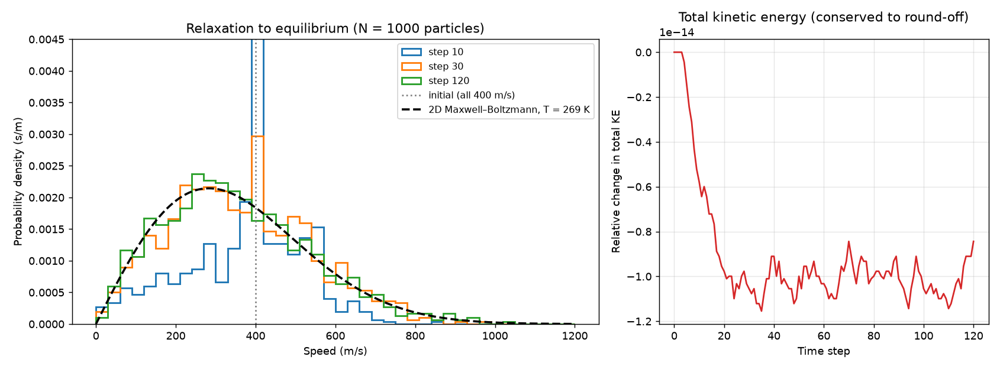

# Monte Carlo Simulation of a Gas in a Box

A 2D simulation of a dilute nitrogen-like gas in a hard-walled box, using a Direct Simulation Monte Carlo (DSMC-style) collision model. Each time step picks a fixed number of candidate particle pairs and accepts each one with probability proportional to its relative speed. Accepted pairs are resolved as exact elastic collisions. Starting from an artificial state where every particle has the same speed, the gas relaxes to the Maxwell–Boltzmann distribution, and total kinetic energy stays constant to machine precision.

<p align="center">
  
  <br><em>Left: all 1000 particles start at 400 m/s, and Monte Carlo collisions drive the speed distribution to the 2D Maxwell–Boltzmann curve for the same energy (T ≈ 269 K) within about 30 steps. Right: total kinetic energy changes by less than 10⁻¹³ over the run.</em>
</p>

## How it works

- **Box size from kinetic theory.** The box side is a multiple (`factor`) of the mean free path λ = 1/(√2 σ n), where the number density n comes from the pressure and temperature (default 1 bar, 1000 K). Each simulated particle stands for `FN` real molecules.
- **Collision sampling** (`particleCollisionMC`). The number of candidate pairs per step is ½ N(N−1) F_N σ (v_r)_max Δt / V. A pair is accepted if v_r / (v_r)_max > U(0, 1). (v_r)_max updates on the fly whenever a faster pair is seen.
- **Elastic collision resolution** (`velocityCalculation`). Uses the angle-free vector form of a 2-body elastic collision, which conserves momentum and energy exactly.
- **Wall collisions** (`newWallCollision`). Specular reflection that never lets a particle cross the boundary.
- **Alternative classical mode** (`particleCollisionClassical`, `wallCollision` + `eulerCromer`). Deterministic overlap-based collision detection, kept for comparison.
- **Observables.** Mean and RMS speed, temperature (from ⟨v²⟩), total energy, and speed histograms.

## Running

Requires Python ≥ 3.13.

```bash
pip install matplotlib numpy scipy sympy   # or: uv sync
python plotGraph.py                        # live speed-distribution animation
```

Other scripts:

| File | Purpose |
|------|---------|
| `Simulation.py` | Simulation core: initialisation, wall/particle collisions, observables |
| `Particles.py` | `Particle` class (N₂ defaults: m = 4.65×10⁻²⁶ kg, r = 1.85×10⁻¹⁰ m) |
| `plotGraph.py` | Animated histogram of particle speeds |
| `theory.py` | Compares simulated mean, RMS and most-probable speeds and collision frequency with kinetic theory |
| `stats.py` | Maxwell–Boltzmann distribution and speed helpers |
| `test_assert.py` | Hand-checked scenarios for wall and head-on particle collisions (prints the resulting states) |

```bash
python test_assert.py
python theory.py
```

## Context

Individual computational-physics project, Lancaster University (Nov 2022 – Jan 2023).
